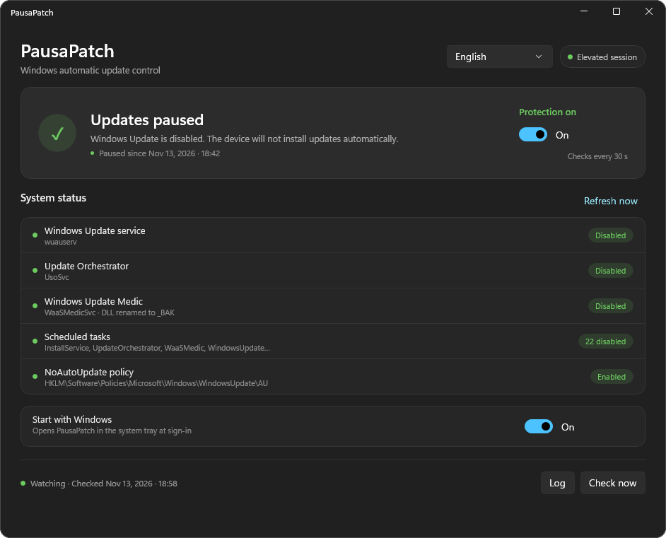
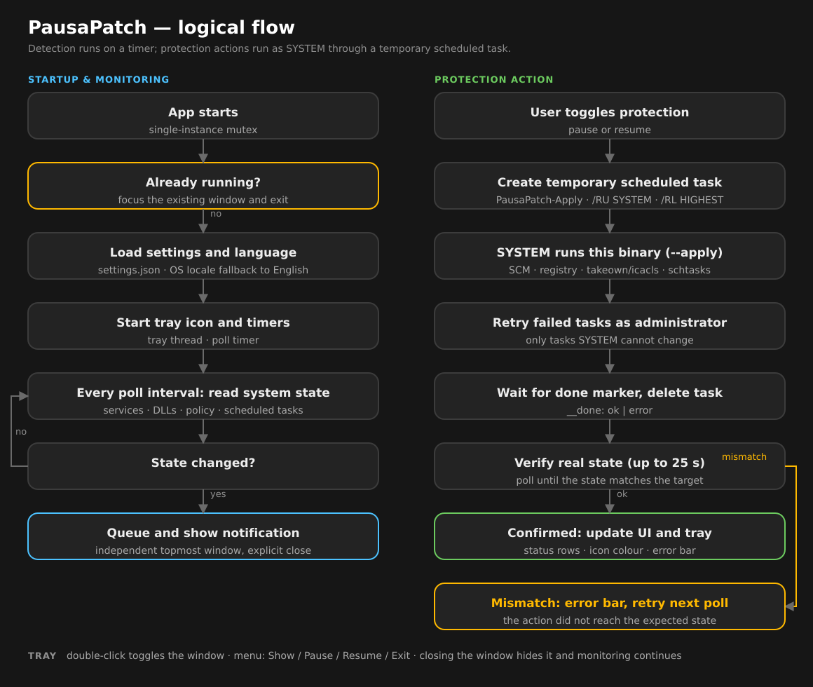
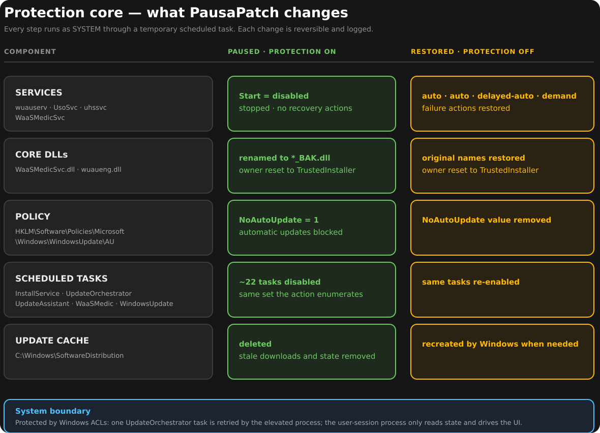

# PausaPatch

<p align="center">
  
</p>

A native Windows 11 utility that pauses or restores automatic Windows updates from a WinUI 3 interface written in Rust with [`windows-reactor`](https://github.com/microsoft/windows-rs/tree/master/crates/libs/reactor).

PausaPatch is the GUI counterpart of [`windows-update-disabler`](https://github.com/tsgrgo/windows-update-disabler): it keeps the same service, DLL, policy and scheduled-task logic, and adds live status, periodic checks, explicit notifications, start-with-Windows and eight languages.

## Why it exists

Windows Update decides on its own when to download, install and reboot. For most people that is the right behaviour; for some workflows it is the one variable you cannot control. PausaPatch makes that variable explicit: one switch, a visible state, and a log of every change, so you can pause updates while you work and restore them when you are done.

Typical cases:

- **Virtual machines and test benches.** Snapshots stay reproducible: an update cannot land halfway through a test run and invalidate the result, and restoring an update means restoring the machine to a known state.
- **Machines where updates are managed centrally.** When WSUS, Intune or a configuration-management pipeline owns patching, the local agent should not pull updates on its own schedule.
- **Long or unattended work.** Renders, compilations, data migrations, demonstrations and kiosks where a surprise restart is not acceptable.
- **Reproducible environments.** Same image, same patch level: you decide when the baseline moves.

Nothing is hidden and nothing is permanent: every change is reversible from the same toggle, and the log records what was modified so the machine can always be returned to its original configuration.

## Features

- **Live status** of `wuauserv`, `UsoSvc`, `uhssvc`, `WaaSMedicSvc`, the `NoAutoUpdate` policy, the renamed DLLs and the update-related scheduled tasks.
- **Protection toggle**: pauses or restores updates using native Windows operations, without scripts or helper processes.
- **Automatic checks every 30 seconds** (configurable through `poll_seconds` in `%LOCALAPPDATA%\PausaPatch\settings.json`, 5 to 3600 s). When the state changes, the UI updates and an independent, always-on-top notification appears in the bottom-right corner.
- **Explicitly dismissed notifications**: they never close on their own. They stay until you press the X, *Ignore* or *Pause again*. Multiple changes are queued.
- **System tray icon** with a *Show*, *Pause*, *Resume* and *Exit* menu. The icon is green while protection is active and amber otherwise. Double-clicking it toggles the main window; closing the window hides it and monitoring continues.
- **Start with Windows** through a `PausaPatch` scheduled task with a logon trigger and `RunLevel HighestAvailable`. A `Run` registry entry would not work: Windows silently drops logon processes that require UAC. The app starts with `--minimized`, that is, tray-only.
- **8 languages**: Spanish, English, German, French, Italian, Simplified Chinese, Japanese and Russian. The OS language is detected at startup and English is used as fallback; the manual selection is stored in the settings file.
- **WinUI 3 dark theme**, custom icon and a `requireAdministrator` manifest.

## How it works



Two independent loops drive the app:

1. **Monitoring.** On a timer, PausaPatch reads the real system state (service start types, DLL names, policy value and scheduled-task states), compares it with the previous reading and queues a notification when something changed outside the app.
2. **Protection.** Pressing the toggle creates a temporary scheduled task that runs this same executable as `SYSTEM` with `--apply pause|resume`. That child performs every operation natively, reports back through the log, and the parent verifies the outcome for up to 25 seconds before updating the UI.

Operations must run as `SYSTEM` because the `UpdateOrchestrator` and `WaaSMedic` tasks cannot be modified even by an elevated administrator. The single exception is retried by the parent as administrator.

## Structure

```
src/
  main.rs      Components and views (main window, notification, log dialog)
  i18n.rs      Translations, language detection and date formatting
  state.rs     State detection and change model
  apply.rs     Native operations: SCM, registry, DLLs, scheduled tasks, cleanup
  tray.rs      Tray icon: hidden window, menu and command queue
  win.rs       Win32: elevation, monitors, topmost, modal windows, autostart
  settings.rs  Persisted settings
  paths.rs     Paths under %LOCALAPPDATA%\PausaPatch
  log.rs       Single append-only log: levels and reading

assets/        Icons (tray on/off, application) and SVG sources
docs/          Screenshot, logical flow and protection core diagrams
scripts/       Cross-build and diagnostic helpers
```

## Requirements

- Windows 11 x64.
- [Windows App Runtime 2.6.4](https://learn.microsoft.com/windows/apps/windows-app-sdk/downloads) installed for framework-dependent builds, or a self-contained build (see below).
- Rust 1.95 or newer to compile.

## Building from Linux (cross-compilation)

The project targets `x86_64-pc-windows-msvc` using `xwin` and LLVM:

```bash
# Once, if the target is not installed:
rustup target add x86_64-pc-windows-msvc

./scripts/build-windows.sh
```

The script defaults to:

- `RUSTUP_HOME=$HOME/.rustup`
- `XWIN_DIR=$HOME/.xwin-cache/splat` (the `xwin splat` output directory)
- `lld-link` plus the xwin libraries through `CARGO_TARGET_X86_64_PC_WINDOWS_MSVC_LINKER` and `CARGO_TARGET_X86_64_PC_WINDOWS_MSVC_RUSTFLAGS`

Any value can be overridden:

```bash
RUSTUP_HOME="/path/to/rustup-home" XWIN_DIR="/path/to/xwin" ./scripts/build-windows.sh
```

The executable is written to:

```
target/x86_64-pc-windows-msvc/release/pausapatch.exe
```

## Building on Windows

```powershell
cargo build --release
```

## Self-contained build (no runtime installation)

On Windows, with the Windows SDK and `curl.exe`/`tar.exe` available:

```powershell
$env:PAUSAPATCH_SELF_CONTAINED = "1"
cargo build --release
```

`windows-reactor-setup` downloads and stages the Windows App Runtime next to the executable. Distribute **the whole** `target\release` folder (the `.exe` plus the runtime DLLs and folders), not just the `.exe`. The generated manifest is extended with `requireAdministrator`.

On Linux the variable is ignored with a warning: cross-builds always produce the framework-dependent variant.

## Usage

1. Download `pausapatch.exe` from the [Releases](../../releases) page, or build it yourself, and run it. Windows asks for elevation (UAC) because of the manifest. The version is shown next to the title in the header.
2. The current state is shown on the main card. The toggle enables protection (pause) or disables it (restore).
3. Periodic checks keep running while the window is minimized, hidden or closed. If Windows re-enables something on its own, the notification appears.
4. The tray icon shows the window, pauses or resumes updates and exits the app. *Exit* is the only way to terminate PausaPatch while the window is hidden.
5. *Start with Windows* creates a logon scheduled task with highest privileges, so PausaPatch starts elevated without a UAC prompt. Turning it off deletes the task (and any legacy `Run` entry).

## What it does exactly



When pausing:

- Sets `wuauserv`, `UsoSvc`, `uhssvc` and `WaaSMedicSvc` to `disabled` and stops them.
- Clears the recovery actions of those services.
- Renames `WaaSMedicSvc.dll` and `wuaueng.dll` to `*_BAK.dll`, adjusting ownership and ACLs.
- Writes `WaaSMedicSvc\Start=4` and its failure actions through the registry when the service API is denied.
- Sets the `NoAutoUpdate=1` policy.
- Deletes `C:\Windows\SoftwareDistribution`.
- Disables the tasks under `InstallService`, `UpdateOrchestrator`, `UpdateAssistant`, `WaaSMedic`, `WindowsUpdate` and `WindowsUpdate*`.

When restoring:

- Returns the services to `auto`, `auto`, `delayed-auto` and `demand`.
- Restores the original DLLs from `*_BAK.dll`.
- Restores `WaaSMedicSvc` and removes the `NoAutoUpdate` value.
- Re-enables the scheduled tasks.

Every step is logged, including `schtasks` enumerations and the administrator retry, in a single append-only file.

## Data paths

`settings.json` stores the language, the last known state and the check interval (`poll_seconds`, 30 by default).

```
%LOCALAPPDATA%\PausaPatch\
  settings.json
  pausapatch.log      (single append-only log)
```

## Diagnostics

```powershell
# Lists the update-related scheduled tasks, including duplicate rows reported by schtasks
.\scripts\list-tasks.ps1

# Shows service start types, DLL state, event 7040 history and repair tasks
.\scripts\diagnose-wuauserv.ps1

# Additionally enables registry auditing to identify what re-enables wuauserv
.\scripts\diagnose-wuauserv.ps1 -EnableAudit
```

## Uninstalling

1. Turn off *Start with Windows* (deletes the `PausaPatch` scheduled task).
2. Use the toggle to restore updates (services, DLLs, policy and tasks).
3. Quit PausaPatch and delete `%LOCALAPPDATA%\PausaPatch`.

## Warning

Pausing updates leaves the machine without security patches. Restore them periodically to install updates and pause again afterwards. Do not interrupt an update that is already running.

## License

[MIT](LICENSE) © bakasura · [bakasura.im](https://bakasura.im)
